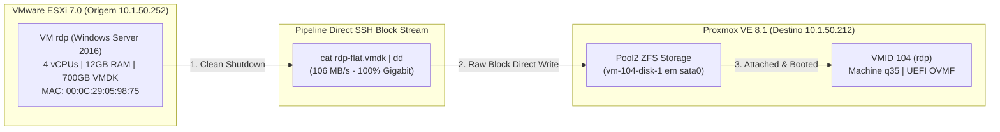

# 📖 Manual Unificado de Migração V2V: VMware ESXi 7.0 ➔ Proxmox VE 8.1
> **Ambiente Alvo:** Windows Server 2016 (64-bit), UEFI / OVMF, 4 vCPUs, 12 GB RAM, 700 GB Storage  
> **VM Alvo:** `rdp` (`10.1.50.14`) | **MAC Address:** `00:0C:29:05:98:75`  
> **Servidor Origem (ESXi):** `10.1.50.252` | **Servidor Destino (Proxmox):** `10.1.50.212` (`moov`)

---

## 📌 1. Visão Geral da Arquitetura & Diretrizes

Este manual consolida o procedimento operacional padrão para migração de alta performance e disponibilidade de máquinas virtuais Windows de grande porte (700GB+) do VMware ESXi para o Proxmox VE.



---

## 📋 2. Checklists Pré-Migração (Fase de Planejamento)

- [x] **Consolidação de Snapshots:** Garantir que a VM na origem não possui snapshots ativos (descartar/consolidar "Delete All").
- [x] **BitLocker / Criptografia:** Confirmar que o BitLocker está desativado (`manage-bde -status`).
- [x] **Chaves SSH sem Senha:** Configurar par de chaves entre Proxmox e ESXi.
- [x] **Mapeamento de Rede:** Anotar o MAC Address original (`00:0C:29:05:98:75`) e as configurações de IP estático (`10.1.50.14/24`, GW `10.1.50.1`).
- [x] **Coleta da Chave de Licença do Windows (Product Key):** Extrair a chave de licença ativa antes da migração (instruções abaixo).
- [x] **ISO VirtIO Presente:** ISO `virtio-win.iso` disponível no Proxmox em `/var/lib/vz/template/iso/virtio-win.iso`.

---

## 🔑 3. Configuração de Chaves SSH e Extração de Licença Windows

### A. Chaves SSH sem Senha (Proxmox ➔ ESXi)
A API HTTP do VMware limita conexões longas. O SSH direto garante velocidade máxima sustentada (106 MB/s):

1. **Gerar a chave no Proxmox VE (`10.1.50.212`):**
   ```bash
   ssh-keygen -t ed25519 -N "" -f ~/.ssh/id_ed25519
   ```
2. **Copiar a chave para o VMware ESXi 7.0 (`10.1.50.252`):**
   ```bash
   cat ~/.ssh/id_ed25519.pub | ssh root@10.1.50.252 "cat >> /etc/ssh/keys-root/authorized_keys"
   ```
3. **Validar acesso:** `ssh root@10.1.50.252 "esxcli system version get"`

### B. Extração da Chave de Licença do Windows (Product Key)
A mudança de hardware virtual (placa-mãe Q35 e barramento de disco) faz o Windows solicitar a reativação da licença. Extraia a chave no Windows da VM de origem ou na nova VM:

1. **Extrair a chave via PowerShell (Executar no Windows):**
   ```powershell
   $map="BCDFGHJKMPQRTVWXY2346789"; $value = (get-itemproperty "HKLM:\SOFTWARE\Microsoft\Windows NT\CurrentVersion").digitalproductid[52..66]; $productKey = ""; for ($i = 24; $i -ge 0; $i--) { $r = 0; for ($j = 14; $j -ge 0; $j--) { $r = ($r * 256) -bxor $value[$j]; $value[$j] = [math]::Floor([double]($r / 24)); $r = $r % 24 }; $productKey = $map[$r] + $productKey; if (($i % 5 -eq 0) -and ($i -ne 0)) { $productKey = "-" + $productKey } }; Write-Host "Chave do Windows: $productKey"
   ```
   *Alternativa OEM:*
   ```powershell
   (Get-WmiObject -query 'select * from SoftwareLicensingService').OA3xOriginalProductKey
   ```

2. **Re-aplicar e Ativar a Licença no Windows (CMD Administrador):**
   ```cmd
   slmgr.vbs /ipk XXXXX-XXXXX-XXXXX-XXXXX-XXXXX
   slmgr.vbs /ato
   ```

---

## 🚀 4. Passo-a-Passo Operacional Completo

### FASE 1: Desligamento Consistente e Criação da VM 104
1. **Desligar a VM original no ESXi:**
   ```cmd
   shutdown /s /t 0
   ```
2. **Provisionar a VMID 104 no Proxmox VE (CLI ou GUI):**
   ```bash
   qm create 104 --name rdp \
     --memory 12288 --cores 4 --cpu host \
     --machine pc-q35-8.1 --bios ovmf \
     --ostype win10 \
     --net0 virtio=00:0C:29:05:98:75,bridge=vmbr0
   ```
3. **Criar o Disco EFI (OVMF) no ZFS Pool:**
   ```bash
   qm set 104 --efidisk0 Pool2:1,format=raw,efitype=4m,pre-enrolled-keys=0
   ```

---

### FASE 2: Streaming de Dados de Alta Performance (`cat` + `dd`)
```bash
# Executado em background (nohup) no Proxmox VE (10.1.50.212)
nohup ssh root@10.1.50.252 "cat '/vmfs/volumes/datastore1/rdp/rdp-flat.vmdk'" | \
  dd of=/dev/zvol/Pool2/vm-104-disk-1 status=progress bs=1M > /tmp/migration_rdp.log 2>&1 &
```
* **Acompanhar progresso:** `tail -f /tmp/migration_rdp.log`

---

### FASE 3: Boot Nativo e Injeção dos Drivers VirtIO
1. **Vincular o Disco Copiado como `sata0` (Boot Seguro Inicial):**
   ```bash
   qm set 104 --sata0 Pool2:vm-104-disk-1
   qm set 104 --boot order=sata0
   ```
2. **Montar a ISO do VirtIO no CD-ROM:**
   ```bash
   qm set 104 --ide2 local:iso/virtio-win.iso,media=cdrom
   ```
3. **Ligar a VM e Acessar o Console VNC:** `qm start 104`
4. **Instalação dos Drivers no Windows:**
   * Executar o instalador oficial no CD-ROM: **`D:\virtio-win-guest-tools.exe`**.
   * *Nota:* Instala os certificados da Red Hat, drivers de rede VirtIO e o **QEMU Guest Agent**.

---

### FASE 4: Conversão Homologada para VirtIO SCSI (`scsi0` com SSD Emulation)
1. **Elevar os drivers VirtIO para Boot no Registro (CMD Admin no Windows):**
   ```cmd
   sc config vioscsi start= boot
   sc config viostor start= boot
   shutdown /s /t 0
   ```
2. **Virada de Barramento no Proxmox VE:**
   ```bash
   qm set 104 --delete sata0 --scsi0 Pool2:vm-104-disk-1,ssd=1
   qm set 104 --boot order=scsi0
   qm set 104 --ide2 none
   qm set 104 --agent enabled=1
   qm start 104
   ```

---

### FASE 5: Finalização, Ativação do Windows e Limpeza de Rede
1. **Limpeza de Placa de Rede Fantasma (Windows CMD Admin):**
   ```cmd
   set devmgr_show_nonpresent_devices=1
   start devmgmt.msc
   ```
   * Em **Exibir ➔ Mostrar dispositivos ocultos**, desinstalar a placa antiga **Intel 82574L**.
2. **Configurar IP Fixo (VirtIO Ethernet):** `10.1.50.14/24` (GW `10.1.50.1`, DNS `10.1.50.1`).
3. **Reativação da Licença do Windows:**
   * Executar o comando `slmgr.vbs /ipk SUACHAVE` e `slmgr.vbs /ato`.
4. **Remover VMware Tools:** Painel de Controle ➔ Desinstalar VMware Tools.
5. **Desacoplamento e Restauração de Volume de Dados Secundário (ex: Marketing 800 GiB):**
   * Provisionar disco no Proxmox: `qm set 104 --scsi1 Pool2:800,ssd=1`.
   * Inicializar GPT e formatar NTFS no Windows (`diskmgmt.msc`).
   * Executar restauração dos dados via script automatizado `restore_marketing.sh` (CIFS + rsync do pool ZFS para o Windows).

---


## ⚖️ 5. Padrão de Arquitetura de Disco Homologado (SATA0 ➔ VirtIO SCSI)

| Recurso / Característica | **Barramento SATA (Boot Provisório)** | **Barramento VirtIO SCSI (Produção Final)** |
| :--- | :--- | :--- |
| **Risco de Tela Azul (`BSOD`)** | 🟢 **Zero (Boot Nativo Garantido)** | 🟢 **Zero (Após `sc config vioscsi start= boot`)** |
| **Estabilidade em Go-Live** | 🟢 **Excelente como ponte** | 🟢 **Homologado e 100% Estável** |
| **Performance de I/O** | 🟢 **90-95% do ZFS Pool** | 🟢 **Máxima (100% Para-virtualizada + TRIM/SSD)** |
| **Uso de CPU no Proxmox** | 🟡 Leve emulação AHCI em software | 🟢 Comunicação direta via kernel |

> **Veredito Operacional Homologado:** O método seguro em duas etapas (1º boot em `sata0` ➔ instalação de ferramentas ➔ `sc config vioscsi start= boot` ➔ conversão para `scsi0`) elimina completamente qualquer risco de tela azul e entrega a performance máxima de I/O e emulação SSD. Consulte o [PLAYBOOK_MIGRACAO_V2V.md](file:///home/dani/Documentos/MigracaoV2VWindows/PLAYBOOK_MIGRACAO_V2V.md) para execução rápida.

---

## 🛡️ 6. Matriz de Resolução de Problemas (Troubleshooting)

| Erro / Sintoma | Causa Raiz | Solução Testada & Validada |
| :--- | :--- | :--- |
| **Reativação do Windows Solicitada** | Troca de ID de placa-mãe/placa de rede virtual (Q35/VirtIO). | Extrair a chave com script PowerShell e aplicar `slmgr.vbs /ipk CHAVE` + `slmgr.vbs /ato`. |
| **Timeout I/O em FUSE/Import HTTP** | API do Proxmox/FUSE sofre timeout em arquivos VMDK >500GB. | Utilizar streaming direto por SSH: `cat rdp-flat.vmdk \| dd of=/dev/zvol/...`. |
| **Device not working properly (Code 31)** | Falta dos certificados de assinatura Red Hat no Windows 2016. | Executar **`virtio-win-guest-tools.exe`** da raiz do CD VirtIO. |
| **INACCESSIBLE_BOOT_DEVICE (BSOD)** | Driver `vioscsi` com `Start = 3` (Demand) em vez de `0` (Boot). | Manter em barramento **`sata0`** ou executar `sc config vioscsi start= boot`. |
| **UEFI Interactive Shell v2.2** | Perda do ponteiro NVRAM no `efidisk` após reconfiguração de disco. | Resetar EFI Disk (`qm set 104 --delete efidisk0 ...`) ou executar `FS0:\EFI\Boot\bootx64.efi`. |

---
*Manual padronizado para migrações V2V de alta criticidade.*
