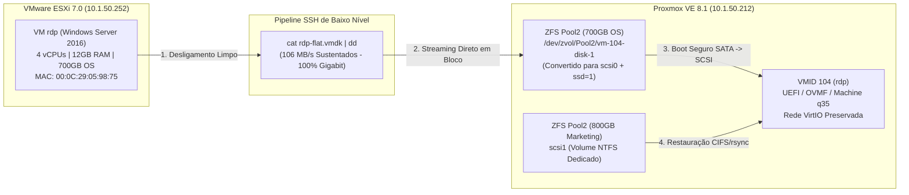

# 🚀 Projeto de Migração V2V: VMware ESXi ➔ Proxmox VE

> **Servidor Alvo:** Windows Server 2016 (64-bit) | 4 vCPUs | 12 GB RAM | 700 GB OS + 800 GB Dados | UEFI (OVMF)  
> **Origem:** VMware ESXi 7.0 (`10.1.50.252`)  
> **Destino:** Proxmox VE 8.1.10 (`10.1.50.212` - Host `moov`)  
> **Status:** 🟢 **100% Concluído com Sucesso & Operando em Produção**

---

## 📌 Visão Geral do Projeto

Este repositório reúne toda a documentação de engenharia, playbooks de execução passo a passo, relatos de caso e scripts de automação utilizados na migração de infraestrutura virtual (**V2V**) de um servidor corporativo crítico Windows Server (Remote Desktop Services / RDP) do ambiente legadom VMware ESXi para um cluster Proxmox VE com armazenamento ZFS.

A migração foi executada com **zero perda de dados**, **zero tela azul (BSOD)**, preservação de identidade de rede (MAC Address e IP) e ativação íntegra das licenças de software.

---

## 🏗️ Arquitetura da Solução & Pipeline de Dados



---

## 💡 Principais Desafios de Engenharia Superados

| Desafio Encontrado | Causa Raiz | Solução Aplicada |
| :--- | :--- | :--- |
| **Timeout de I/O em arquivos >500GB** | API HTTP/FUSE do Proxmox estoura tempo limite em imagens grandes. | Pipeline assíncrono via SSH direto (`cat` + `dd`), atingindo **106 MB/s** e transferindo 751 GB em 1h58m. |
| **Driver VirtIO Recusado (`Code 31`)** | Falta da cadeia de certificados raiz da Red Hat no Windows Server 2016. | Execução do instalador oficial **`virtio-win-guest-tools.exe`**, que registra automaticamente a CA raiz. |
| **Tela Azul (`INACCESSIBLE_BOOT_DEVICE`)** | Driver VirtIO SCSI instalado com `Start = 3` (Demand) não sobe no boot. | **Boot Seguro em 2 Etapas:** Primeiro boot em `sata0` nativo, promoção via `sc config vioscsi start= boot` e virada para `scsi0` (`ssd=1`). |
| **Loop no UEFI Interactive Shell v2.2** | NVRAM (`efidisk0`) reteve ponteiros PCI antigos da topologia VMware. | Reset do disco EFI (`pre-enrolled-keys=0`) e apontamento fallback `FS0:\EFI\Boot\bootx64.efi`. |
| **Conflito de IP e Hardware Fantasma** | Adaptador de rede antigo VMware esmaecido retendo o IP corporativo. | Exibição de dispositivos ocultos (`devmgr_show_nonpresent_devices=1`), remoção da placa antiga e preservação do MAC Address na VirtIO. |
| **Volume Gigante de Dados Secundários** | Volume de Marketing de 800 GiB no disco do sistema gerava gargalos. | Desacoplamento para disco secundário (`scsi1`) e sincronização/restauração automatizada via CIFS/rsync. |

---

## 📂 Estrutura do Repositório

```text
├── PLAYBOOK_MIGRACAO_V2V.md      # Guia rápido e operacional passo a passo com índice
├── MANUAL_UNIFICADO_MIGRACAO_V2V.md # Manual técnico detalhado e padrões de arquitetura
├── JORNADA_E_CASE_MIGRACAO_V2V.md   # Relato de caso, desafios (mazelas) e diagnósticos
├── ROADMAP_MIGRACAO_V2V_LINKEDIN.md # Linha do tempo, diagramas e modelo de case para LinkedIn
├── ROTEIRO_GRAVACAO_VIDEO_MIGRACAO.md # Roteiro estruturado para gravação de vídeo técnico / Tech Talk
├── TODO.md                          # Histórico de homologação e checklist do go-live

├── credentials.env.example         # Modelo seguro de variáveis/credenciais CIFS (sem segredos)
├── sync_marketing.sh                # Script de cópia prévia de segurança (CIFS + rsync)
├── restore_marketing.sh             # Script de restauração pós-formatação (CIFS + rsync)
├── .agents/                         # Instruções e contexto para agentes inteligentes
│   ├── AGENTS.md
│   └── GEMINI.md
└── archive/                         # Rascunhos, scripts e documentações legadas
```


---

## 🛠️ Scripts Operacionais

### 1. `sync_marketing.sh`
Realiza a sincronização incremental prévia a quente dos dados compartilhados da rede (`//10.1.50.14/SETOR MARKETING`) diretamente para o pool ZFS do Proxmox (`/Pool2/marketing_backup`), reduzindo o tempo de corte final.
```bash
# Executado no Proxmox VE
./sync_marketing.sh
```

### 2. `restore_marketing.sh`
Restaura os dados do pool ZFS para a nova unidade formatada em NTFS (`scsi1`) vinculada à VM já em produção no Proxmox.
```bash
# Executado no Proxmox VE
./restore_marketing.sh
```

---

## 🔮 Próximos Passos da Infraestrutura

Com a superação completa do desafio heterogêneo (**VMware ➔ Proxmox**), a infraestrutura atinge um novo patamar de maturidade. As próximas migrações planejadas serão **Proxmox para Proxmox**, permitindo o uso integral das ferramentas nativas:
- `qm remote-migrate` (migração ao vivo e a frio entre clusters/nós distintos via túnel SSH/Websockets).
- Replicação e sincronização direta de ZFS Pools (`zfs send` / `zfs receive`).
- Backups integrados e desduplicados com o **Proxmox Backup Server (PBS)**.

---
*Documentação consolidada pela equipe de Engenharia e Infraestrutura.*
