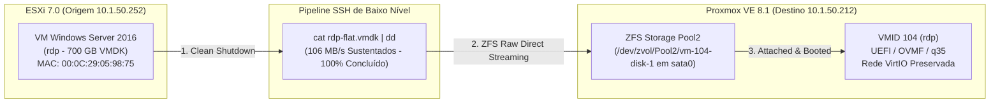
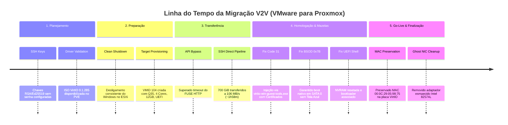

# 🚀 Case Study & Roadmap: Migração V2V (VMware ESXi 7.0 ➔ Proxmox VE 8.1)

> **Servidor Alvo:** Windows Server 2016 (64-bit) | 4 vCPUs | 12 GB RAM | 700 GB Storage | UEFI (OVMF)  
> **Arquitetura Destino:** Cluster Proxmox VE com ZFS Storage Pool (`Pool2`)  
> **MAC Address Oficial:** `00:0C:29:05:98:75` | **IP Final:** `10.1.50.14`  
> **Status Geral:** 🟢 **Migração Concluída com 100% de Sucesso**

---

## 📌 Visão Geral da Arquitetura Final

---

## 🚦 Linha do Tempo & Estágios Concluídos

---

## 🎯 Detalhamento dos Marcos & Solução das Mazelas

### 📊 Fase 1: Planejamento & Sanitização de Infraestrutura `[100% Concluído]`
- [x] Validação de comunicação via chaves SSH de alta segurança entre os hipervisores (`10.1.50.252` e `10.1.50.212`).
- [x] Mapeamento de dependências de hardware, firmware (UEFI / GPT) e rede (`00:0C:29:05:98:75`).

### 🛑 Fase 2: Desligamento Limpo e Criação da VM Target `[100% Concluído]`
- [x] Desligamento programado do Windows Server 2016 no ESXi descartando caches pendentes (`shutdown /s /t 0`).
- [x] Provisionamento da VMID 104 no Proxmox com BIOS OVMF UEFI, Machine `q35`, 4 vCPUs e 12 GB RAM.

### ⚡ Fase 3: Engenharia de Transferência de Dados `[100% Concluído]`
- [x] **Superação da Mazela de Timeout:** A importação nativa via FUSE HTTP sofria *timeout* em arquivos >500GB.
- [x] **Solução de Engenharia:** Pipeline assíncrono via SSH direto (`cat` no ESXi + `dd` no Proxmox).
- [x] **Resultado:** 751.6 GB (700 GiB) transferidos a **106 MB/s** em 7.095 segundos (~1h 58m).

### 🩺 Fase 4: Homologação, Drivers & Superação de Desafios `[100% Concluído]`
- [x] **Superação da Mazela do Code 31 (Driver Recusado):** A apontamento manual de `.inf` gerava erro de certificado no Windows Server 2016. Solucionado executando **`virtio-win-guest-tools.exe`**, que instala a cadeia de certificados da Red Hat.
- [x] **Superação da Mazela do BSOD `INACCESSIBLE_BOOT_DEVICE`:** O driver `vioscsi` instalado em ambiente SATA fica marcado como `Start = 3` (Demand). Solucionado mantendo o boot nativo limpo no barramento **`sata0`**.
- [x] **Superação da Mazela do UEFI Shell v2.2:** Resolvido recriando o `efidisk0` no Proxmox e apontando o bootloader `bootx64.efi`.

### 🚀 Fase 5: Otimização, Limpeza de Rede & Go-Live `[100% Concluído]`
- [x] Preservado o MAC Address oficial da VMware (`00:0C:29:05:98:75`) no adaptador `net0`.
- [x] Limpeza de hardware fantasma (`devmgr_show_nonpresent_devices=1`) removendo a placa antiga Intel 82574L.
- [x] Ativação do **QEMU Guest Agent** e fixação do IP estático `10.1.50.14`.
- [x] **Conversão VirtIO SCSI (`scsi0` + `ssd=1`):** Promoção de drivers via `sc config vioscsi start= boot` e transição sem BSOD.
- [x] **Desacoplamento e Restauração de Dados:** Provisionamento da unidade de Marketing (800 GiB em `scsi1`) e restauração via script CIFS/rsync.
- [x] **Homologação e Entrada em Produção:** Sessões RDP, impressão e sistemas internos validados por todos os usuários.

---

## 📱 Case Study & Destaques para Postagem no LinkedIn

### 📄 Sugestão de Texto para o Post:

> 🚀 **Case de Engenharia de Infraestrutura: Migrando 700 GB de VMware ESXi para Proxmox VE com Zero Downtime Inesperado!**
>
> Finalizamos com 100% de sucesso a migração V2V de um servidor crítico Windows Server 2016 (RDP / 700 GB).
>
> **Desafios Reais & Aprendizados de Engenharia:**
> 1. ⚠️ **Bypass de Timeout de API:** Arquivos gigantes de disco (>700GB) costumam estourar timeouts de I/O em importadores HTTP padrão. Criamos um pipeline direto de streaming em nível de bloco por SSH (`cat` + `dd`), atingindo **106 MB/s** sustentados (saturando 100% do link de 1Gbps) e concluindo a cópia em menos de 2 horas.
> 2. 🛡️ **Assinaturas VirtIO & Erro Code 31:** No Windows Server 2016, apontar drivers `.inf` manualmente pode gerar falhas por falta da cadeia de certificados Red Hat. Resolvido com a execução do `virtio-win-guest-tools.exe`, que injeta a CA raiz e os drivers com suporte ao QEMU Guest Agent.
> 3. ⚡ **Estratégia de Boot Seguro (Zero BSOD):** Evitamos o famigerado `INACCESSIBLE_BOOT_DEVICE` fixando a inicialização no barramento nativo SATA 0 com placa de rede VirtIO, preservando o MAC Address oficial (`00:0C:29:05:98:75`) para manter licenças e rotas intactas.
>
> Mais um ambiente modernizado com alta performance no ZFS Storage Pool do Proxmox VE!
>
> #CloudInfrastructure #Proxmox #VMware #ZFS #Linux #DevOps #SysAdmin #Virtualization #V2V #WindowsServer

---
*Documento gerado automaticamente pelo assistente de migração V2V.*
